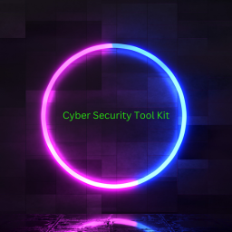

# CyberSecurityToolKit (CSTK)



CyberSecurityToolKit is a menu-driven collection of security assessment,
payload-development, post-exploitation, and support utilities. CSTK is designed
primarily for Kali Linux and Kali under WSL2.

> [!CAUTION]
> Use CSTK only on systems, accounts, applications, and networks that you own
> or are explicitly authorized to test. Several tools can change files,
> credentials, services, or system availability.

## At a glance

| Class | Purpose | Examples |
| --- | --- | --- |
| OSINT | Reconnaissance and vulnerability discovery | IP lookup, Nmap, host sweeps, web enumeration, account checks, SSH enumeration, and WAF detection |
| Payloads | Controlled payload creation for authorized labs | Reverse-shell, encryption, DoS lab, SSH, Metasploit, APK, and command-and-control helpers |
| Post Exploit | Assessment after authorized access | VM detection, browser-data collection, crypto searches, permission and kernel checks, and archive auditing |
| DEFENSE | Read-only configuration assessment | Web/TLS assessment; Linux audit when its executable is available |
| Etc | Supporting utilities | Users, web servers, archives, OpenSSL, hashes, Bash packaging, Zip2Go, and Arsenal help |

## Requirements

- Kali Linux is the primary supported and tested environment.
- Root access through `sudo` is required.
- Git and Git LFS are required to clone the complete private repository.
- Network access is required during installation and update checks.
- Linux x86-64 and ARM64 installs provision the library key automatically using
  bundled helpers containing recoverable key material. The plaintext key is stored
  outside the repository at `/etc/cstk/lib_decryption.key` with root-only access.

The installer contains package mappings for APT, DNF, YUM, and Homebrew, but
Kali Linux receives the most testing.

## Installation

### 1. Enable Git LFS

```bash
git lfs install
```

### 2. Clone the private repository

Use a GitHub account and SSH key that have access to the repository:

```bash
git clone git@github.com:adamhamilton44/CyberSecurityToolKit.git
cd CyberSecurityToolKit
```

### 3. Run the installer

```bash
sudo bash install.sh
```

The installer adds the `cstk` launcher and its restricted wrapper under
`/usr/local/bin/`, installs the manual page and Bash/Zsh tab completion,
records the packages it installs, prepares protected local state, and creates
private Loot, Malware, and runtime Logs folders for the user who invoked
`sudo`.

Installation ownership is recorded in root-only `/var/lib/cstk`. Newly added
system packages (including dependencies) are recorded per package transaction.
CSTK-managed pipx environments, Go tools, and caches live under `/opt/cstk`;
software already present is retained.

To uninstall, run `sudo bash uninstall.sh` from the installed checkout. Cleanup
removes CSTK's key, launcher, wrapper, manual, completion entries, managed tool
environments, and recorded system packages. Files replaced during installation
are restored from the installation ledger. User files under
`~/.local/share/cstk/` and unrelated shell configuration edits are preserved.
A failed removal keeps the checkout and ledger for retry. APT removal is refused
if its plan would also remove an unrecorded package; no blanket autoremove runs.

Older installations have only the original package lists. Their unrecorded
historical dependencies and caches cannot be reconstructed safely. Package
upgrades, package-manager history, system logs, and arbitrary package maintainer
script effects are not reverted to a previous OS snapshot.

### 4. Start CSTK

```bash
sudo cstk
```

## Main menu

| Choice | Action |
| --- | --- |
| `1` | Open the OSINT tools |
| `2` | Open the payload-development tools |
| `3` | Open the post-exploitation tools |
| `4` | Open the supporting utilities |
| `G` | Create, select, validate, pause, and manage engagements; run guarded TCP/web operations |
| `L` | Explicit standalone lab mode with no engagement enforcement (unavailable inside a selected engagement session) |
| `5` | Turn CSTK launcher authentication on or off |
| `6` | Turn animated headers on or off |
| `7` | Manage private Loot/Malware/Logs storage, logging, and backups |
| `8` | Open the DEFENSE tools |
| `U` | Check for and install approved CSTK-managed updates |
| `T` | Display the full TTY shell-upgrade guide |
| `X` | Exit |

Authentication and animated-header preferences are stored locally and are not
committed to Git.

## Command-line help

```bash
sudo cstk -H                 # Short help and examples
sudo cstk --help             # Full option and tool list
sudo cstk -V                 # Version
sudo cstk --tty              # TTY shell-upgrade guide
sudo cstk --check-updates    # Report available managed updates
sudo cstk --update           # Review and install approved managed updates
sudo cstk --private-data     # Manage private output and backups
sudo cstk --control engagements # List engagements through the local control API
man cstk                     # Installed manual page
```

Class and tool options can be combined:

```bash
sudo cstk -On
sudo cstk --osint --nmap
```

The first example uses compact short options. The second uses the equivalent
long options.

The supporting-utilities class also includes CSTK AI Analyst:

```bash
sudo cstk -Ei
sudo cstk --etc --ai
```

The analyst is an original defensive terminal client for an operator-selected
OpenAI-compatible endpoint. It cannot execute model-requested commands, browse
targets, edit files, perform phishing or credential attacks, or run
autonomously. Remote endpoints require HTTPS, keys are referenced through
environment variables or a hidden session-only dialog rather than stored, and
redirects are refused. The
always-visible safety display identifies the provider/model and selected
engagement. Real scope context is withheld unless the phase-two engagement is
active; questionnaire answers and AI proposals remain review-only candidates.

The optional `--control` route requires the separately installed CSTK Local
Control service and client. CSTK runs that client as the invoking user and
uses the user's private loopback API token; it does not run the web service as
root or provide an arbitrary command/adapter interface.

## Updates

CSTK does not contact package indexes or source repositories during normal
startup. Update checks are always user initiated.

To check without installing:

```bash
sudo cstk --check-updates
```

To review and install approved updates:

```bash
sudo cstk --update
```

The combined updater:

- works only with system packages, pipx applications, and GitHub
  repositories recorded or recognized by CSTK;
- shows its scope and asks for confirmation before installing;
- does not perform a full operating-system upgrade;
- does not run `autoremove`;
- refuses to overwrite a dirty or diverged CSTK checkout; and
- updates CSTK itself only through an authenticated, fast-forward-only Git
  pull.

After a CSTK self-update, the already-running trusted launcher privately
requests maintenance authorization, refreshes installed interfaces, rebuilds
and verifies the local checksum manifest, and only then starts the updated
launcher. There is no public integrity-refresh command, and private keys should
never be placed on a command line.

Update logs are written beneath `log/updates/`.

For an SSH remote whose private key is loaded in your user's agent, preserve
its socket across sudo:

```bash
sudo --preserve-env=SSH_AUTH_SOCK cstk --update
```

CSTK validates the agent socket's owner and forwards only that socket when Git
runs as the checkout owner. It never copies the private key. A failed remote
check means the installed branch has not advanced; a clean working tree can
still be behind `origin/main`. Missing or broken pipx environments and missing
third-party source checkouts are separate dependency warnings. The updater does
not reinstall unrelated user applications to repair them.

## Integrity protection

CSTK verifies protected program files before opening its menus or dispatching
tools. The protected set includes the launcher, uninstaller, runtime binaries,
library files, checksum verifier, and installed wrapper when present.

The checksum manifest is generated locally at:

```text
Other/SecurityChecks/sha256.checksum
```

It is deliberately excluded from Git and stored with restrictive permissions.

### What happens when verification fails

CSTK does **not** automatically delete itself.

1. CSTK refuses to run the requested tool.
2. The user may quit without changing anything.
3. The user may explicitly choose deletion and must type a second confirmation.
4. The integrity-screen deletion removes CSTK launchers and core program files
   while preserving local data, collected results, logs, wordlists, and
   installed system packages.
5. Authorized maintenance has a private recovery path for rebuilding the
   manifest; it is intentionally not exposed as a normal command-line option.

An unexpected integrity warning should be treated seriously. Quit, review the
changed files, and restore them from a trusted signed commit unless the change
was intentional.

## Private per-user data and backups

CSTK routes generated Loot, Malware, and runtime tool logs to the home
directory of the account that invoked `sudo cstk`:

| Path | Purpose |
| --- | --- |
| `$HOME/.local/share/cstk/Loot/` | Scan output, reports, and collected assessment results |
| `$HOME/.local/share/cstk/Malware/` | User-generated payloads and executable test artifacts |
| `$HOME/.local/share/cstk/Logs/` | Optional basic metadata or full runtime tool logs |
| `$HOME/.local/share/cstk/Keys/` | Private per-user generated keys and sensitive cryptographic material |
| `$HOME/CSTK-Exports/` | User-requested private backups |

The data folders use mode `700`, and CSTK removes group and other permissions
from their contents. This separates ordinary local accounts. Root and anyone
with equivalent `sudo` access can still read system data.

Open main-menu choice `7`, or run:

```bash
sudo cstk --private-data
```

The private-data manager can:

- reapply private ownership and permissions;
- turn runtime tool logging on or off for future CSTK runs;
- copy old shared `Bank/Loot` and `Bank/Malware` files without overwriting
  private files or deleting the originals;
- create an unencrypted `.tar.gz` backup; or
- create a password-protected `.7z` backup with AES-256 encryption and
  encrypted filenames.

CSTK lets 7-Zip request the password directly and does not store it. Use a
strong password and keep it somewhere safe; CSTK cannot recover it. Backup
files use mode `600`. Treat every archive as sensitive and potentially
dangerous because it may contain credentials or generated payloads.

The logging preference is stored in
`$HOME/.local/share/cstk/.logging_enabled`. `basic` is the default and records
the tool, user, start/end times, working directory, run ID, and exit status.
`full` additionally records command arguments and complete stdout/stderr and
may therefore contain credentials, tokens, targets, or other sensitive data.
`off` prevents new wrapper logs while Loot reports and Malware outputs continue
to be saved. Installer, updater, and uninstaller maintenance logs remain inside
the CSTK program directory because they describe program maintenance rather
than runtime tool activity.

The legacy repository `Bank/` folders remain excluded from Git but are no
longer used for new output. Keep them until the private-data migration has
been checked and backed up. Other local paths excluded from Git include:

| Path | Purpose |
| --- | --- |
| `data/` | Optional breached-account datasets |
| `log/` | Installer, updater, and uninstaller maintenance logs |
| `Other/Downloads/` | Third-party repositories installed at runtime |
| `Other/SecurityChecks/` | Local authentication settings, installation records, and integrity state; only the verifier is committed |

Back up any local material you need before manually removing the CSTK folder.
Never place credentials, private keys, collected browser data, breached-account
records, or generated payloads in a commit or issue.

## Troubleshooting

- Run `git status --short` before updating. CSTK self-update requires a clean
  checkout.
- Run `git lfs pull` if either ZIP asset is unexpectedly represented by a
  small text pointer.
- Review `log/package_manager/` for installation failures.
- Review `log/updates/` for update-check and update failures.
- Use `sudo cstk --tty` for help stabilizing a limited authorized shell.
- Use `man cstk` for the complete installed command reference.

## Project information

- Version: `3.0.5`
- Primary tested platform: Kali Linux
- License: [Other/LICENSE.txt](Other/LICENSE.txt)
- Author: Adam Hamilton
- GitHub: [adamhamilton44](https://github.com/adamhamilton44)
- Contact: [blacklisthacker@protonmail.com](mailto:blacklisthacker@protonmail.com)

Feedback and carefully scoped contributions are welcome. Do not include secrets
or collected assessment data in reports or pull requests.

## About the author

Adam also works as a professional dog trainer:
[Good Happy Puppy](https://good-happy-puppy.com).

## Support the project

Bitcoin: `3ENrACvnNY7AYG7HUvcdwJgZjnpoaQ9Lbt`

## DEFENSE: Web/TLS Security Assessment

```bash
sudo cstk -Dw https://example.com/
sudo cstk --defense --web-tls https://example.com/
# Standalone, without root:
bash scripts/bin/web_tls_security_assessment https://example.com/
```

Menu 8 → DEFENSE → 2 asks for an explicit HTTP/HTTPS URL. DEFENSE 1 and
`-Dl` / `--defense --linux-audit` retain the Linux audit entry; this checkout
has no Linux audit executable and reports SKIP until the prior implementation
is supplied. Private data management is long form only: `--private-data`.

The assessment uses curl and openssl, Bash and standard Unix tools. GNU
`timeout` bounds TLS connections. Missing capabilities produce SKIP/INFO.
It sends GET with a one-byte Range request and OPTIONS to the exact target,
never follows redirects, never replays cookies, and never sends credentials.
Servers may ignore Range; transfers have a 1 MiB advertised size limit and a
10-second timeout. HTTPS port 443 additionally checks `http://host:80/`;
no counterpart port is guessed for custom HTTPS ports. HTTP targets report
redirects and skip TLS; assess the HTTPS destination separately.

Findings cover certificate chain trust and hostname/IP verification, validity
and expiry (including the 30-day window), presented chain identities, negotiated
TLS/cipher/key information and four bounded TLS version probes. Local policy
may prevent legacy negotiation: a failed probe is inconclusive, while a
successful TLS 1.0/1.1 handshake is HIGH. No client security policy is weakened.
Headers include HSTS, CSP, X-Frame-Options, nosniff, Referrer-Policy and
Permissions-Policy. Cookie Secure/HttpOnly/SameSite and __Host-/__Secure- prefix checks redact cookie
values. CSP frame-ancestors is recognized as a framing-policy alternative, and
Report-Only is distinguished from enforcing CSP. Duplicate HSTS fields are
flagged for review. Interim headers and trailers are excluded from the audit. OPTIONS describes advertised methods without exercising unsafe ones.
Header absence is a review finding, not proof of exploitation; applicability
varies for redirects, APIs and authenticated pages. CSP presence alone does
not establish protection. This is not an exhaustive cipher or route scanner.

Private reports are created under `$HOME/.local/share/cstk/Loot/web-tls-*`
(or exported `CSTK_LOOT_DIR`). Summary logs use `Logs` / `CSTK_LOG_DIR` and
honor logging off. Target query values and redirect credentials/path/query/fragment are redacted.
Finding totals appear in both the report and summary log. Remote evidence is
flattened into bounded single-line findings to prevent misleading report lines.
Temporary raw evidence is deleted
on exit; report directories are mode 700 and files mode 600. The launcher runs
the assessment as the invoking user. Exit 0 means the assessment completed,
including findings or skipped checks; 2 means invalid input and 1 output failure.

The installer grants executable permissions; the existing integrity manifest
includes all files under scripts/bin and scripts/lib. Its authenticated refresh
and fast-forward update process is unchanged. Uninstall removes managed scripts,
completion and the manual through the existing lifecycle and retains user reports.

## Portable assessment kit

`scripts/lib/CSTK_Zip2Go.zip` is the portable assessment edition. Extract its
`CSTK_2Go/` directory and read the included README before running
`bash run_me.sh --output /your/report/directory`. No CSTK wrapper or root account
is required. Optional network actions are separate commands. Readable shell
sources support more Linux environments; bundled shc launchers target Linux
x86-64 and still require Bash and their documented dependencies. The archive
includes a checksum manifest and generated launcher sources. Maintainers rebuild
it with `python3 tools/build_zip2go.py` after changing sources. See
[portable toolkit source guide](tools/zip2go/README.md) for scope and validation.

Zip2Go also includes explicit LinPEAS, LES and Unix Priv Check enumeration
profiles. Use `enumeration.sh --tool linpeas`, `--tool les`, or `--tool upc` after
reading the archive README. The profiles record upstream provenance, exact
coverage and omitted checks; successful completion is not a security verdict.

### Optional Katana crawler

CSTK no longer builds Katana during installation or updates. The available
`Osint_enum` source has one optional depth-3 Katana crawl next to a GoSpider
crawl. It skips missing Katana; that limited integration does not justify a
mandatory Go source build and its module downloads. Users who separately install
Katana can retain that optional capability. Older Katana registry entries are
ignored by the updater; existing binaries are not deleted during installation.
Legacy uninstall cleanup remains available. The Go toolchain stays in the
system dependency list for other tooling; this change removes Katana's build.

### Default dependency policy

The dependency audit reduced system install entries from 111 to 95. Unused
packages, local database/SSH servers without a CSTK hosting workflow, catalogue-only
examples and duplicate requirements no longer trigger automatic installation.
Remote database checks retain their client packages. The unused Vulscan clone and
optional naminter/BloodHound collector pipx installs were also removed; the
updater skips their legacy source/pipx records. Existing installations are not
purged by this change. See [tools/dependency_policy.json](tools/dependency_policy.json) for dependency
decisions and rationale. Regenerate local reports with
`python3 tools/audit_dependencies.py`; output goes to ignored `log/development/`. Compiled/source equivalence and package command-name
mismatches are explicitly identified rather than treated as verified coverage.

## Engagement sessions and scope enforcement

Use main-menu **G**, or `sudo cstk --engagements`. Create a draft with the
23-group guided questionnaire; inspect and validate it, then change its state
from draft to ready to active. Use **U** in that manager to select it for the
current process, or start with `sudo cstk --use ENGAGEMENT_ID`. No global active
pointer is used. Existing AI engagements under `~/.local/share/cstk/Engagements`
use the same record format and remain available. The older experimental
lowercase `engagements` tree is not silently moved or merged.

The terminal status area shows the selected client, scope revision/hash,
authorization interval, included/excluded scope, limits, emergency contact,
and ACTIVE or STOP/REVIEW. It refreshes once per second. CSTK menu output uses
a reserved scroll region; the guarded-run screen and AI screen maintain their
own live status. Terminals smaller than 60 columns by 16 rows cannot start a
guarded run. Exiting restores the normal scroll region.

The manager provides two reviewed, unprivileged adapters:

- **N**: sequential TCP connection checks for explicit IP/CIDR targets, at most
  256 addresses and 64 explicit ports, with no application payload.
- **W**: one bounded HTTP(S) GET chain. Every destination is checked before
  connection; all DNS answers must pass strict scope policy, and the connection
  pins a numeric destination and binds the checked local source address.
  Redirects follow the recorded policy, every hop is rechecked, HTTPS downgrade
  is refused, and page links/resources are not fetched. Bodies are not stored;
  only status, bounded byte count, and digest are retained. URL queries are
  excluded from run/audit records.

Every connection/request revalidates lifecycle, authorization dates, testing
windows, selected revision, action, exclusions, protocol/port, and source
address. Each run requires explicit RUN confirmation. Runs are serialized per
engagement, paced to its request limit, capped at five minutes, and watched for
pause, expiry, cancellation, and revision changes. Run records are private and
decisions are audited. A denied destination is fingerprinted when the policy
requires minimal out-of-scope storage. Custom traffic identifiers are applied
only after validating header names/values.

**Scope of enforcement:** legacy scanners, credential tools, payload routes,
post-exploitation routes, unrestricted servers, Arsenal, and the separate
control execution routes have no reviewed adapter here. They are refused
through CSTK engagement dispatch and its wrapper. This release does not claim
that those tools are engagement-safe. Local support utilities and defensive AI
remain available. The selected engagement is automatically shown in the AI;
non-operational records cannot be transmitted as authorization context.

For independent lab use, main-menu **L** requires typing LAB and displays an
unguarded-mode banner. A selected engagement cannot switch into this mode;
exit the process first. This is an explicit unguarded workflow, not an
engagement authorization mechanism. Directly launched programs outside CSTK
are outside this application guard; this is not a host firewall/sandbox.

The checked source is the actual local bound address. NAT/VPN public egress
cannot be established from that value; WSL/NAT engagements whose rules require
an unverifiable public source must remain blocked until the network path is
independently verified. Application reads are paced; TCP/TLS/DNS overhead and
kernel buffering are not a hard network-bandwidth shaper. Stop-condition text,
legal consent, encryption-at-rest, retention, and real-world incident response
still require the operator's controls. DNS resolution uses the host's configured
resolver; it does not probe the target application before URL scope validation.

The new manager is distributed as `scripts/bin/Etc_engagement`, packaged with
PyInstaller. Its editable launcher/adapter source is maintained externally in
`CSTK_bin_files/Engagements`; it imports the same policy source used by the AI.
No existing opaque library resource is renamed or decrypted by this update.
